# MediaShell

Личная библиотека игр, фильмов, сериалов и аниме. Каталоги подключены без ключей API, у каждого пользователя свой аккаунт, а все данные хранятся в одном файле SQLite на вашем компьютере.

_English summary at the end._

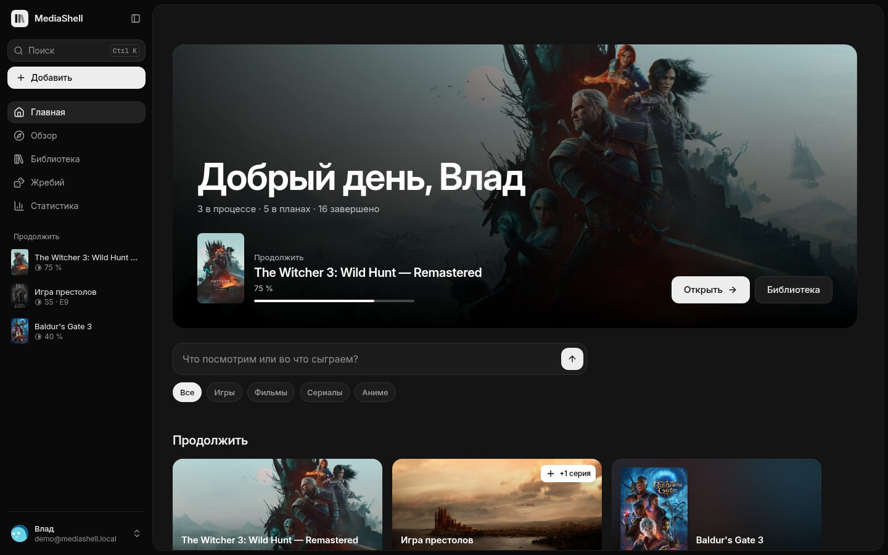

<table>
  <tr>
    <td>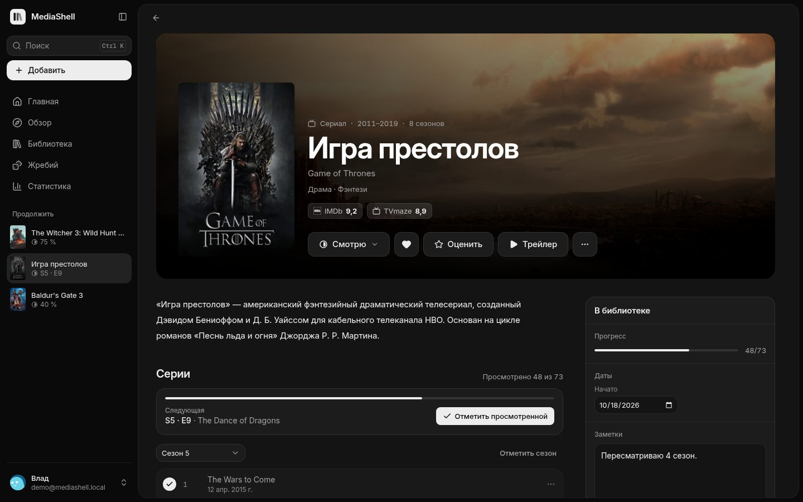</td>
    <td>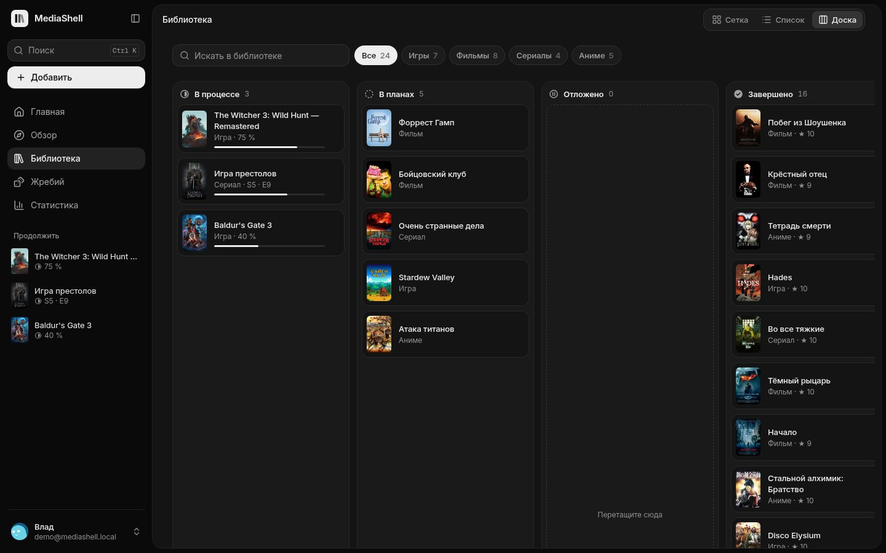</td>
  </tr>
  <tr>
    <td>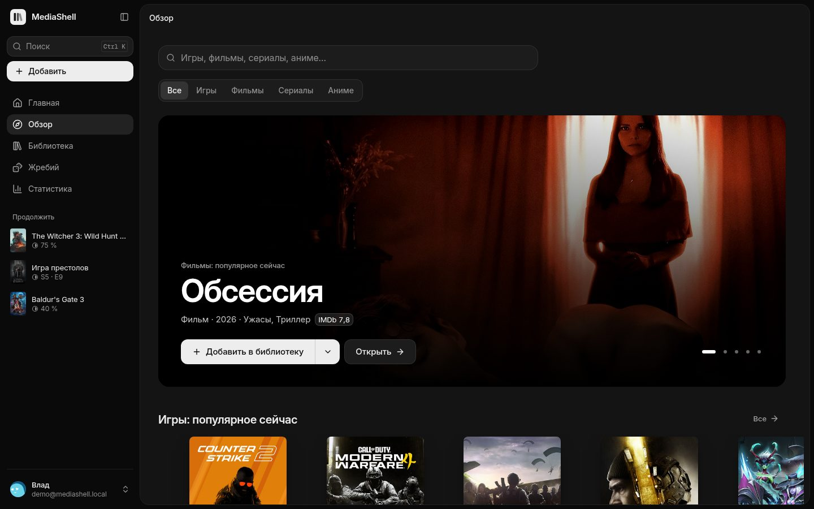</td>
    <td>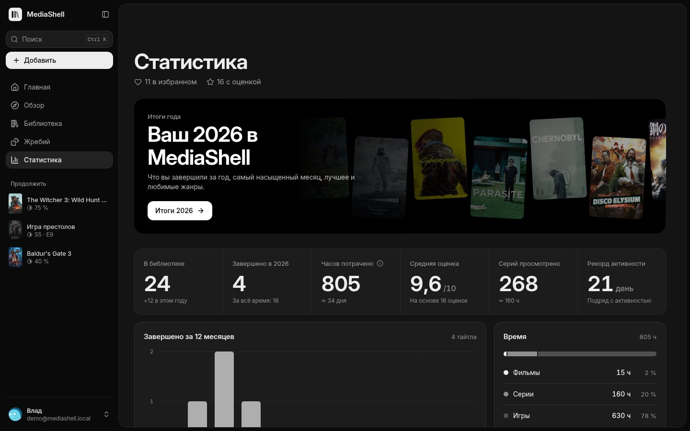</td>
  </tr>
  <tr>
    <td>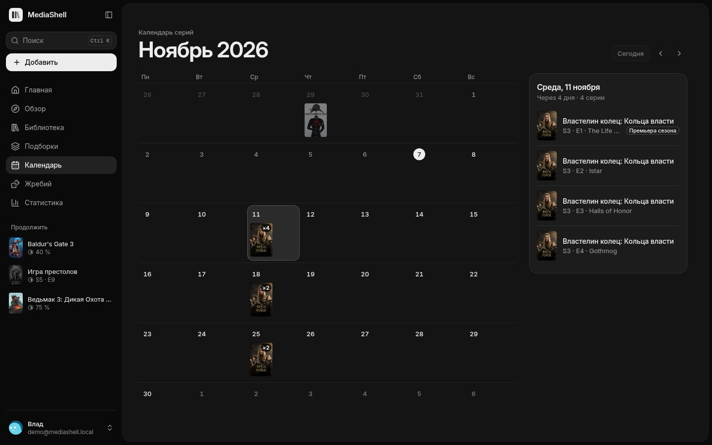</td>
    <td>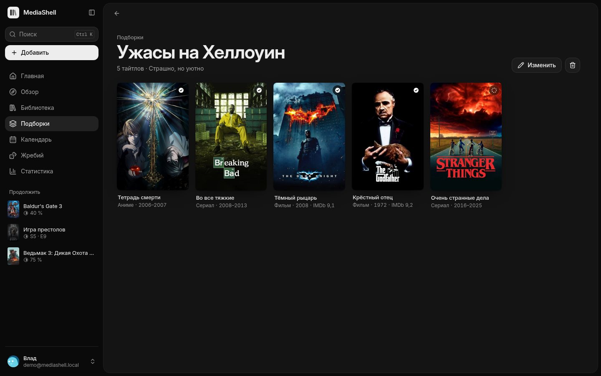</td>
  </tr>
  <tr>
    <td>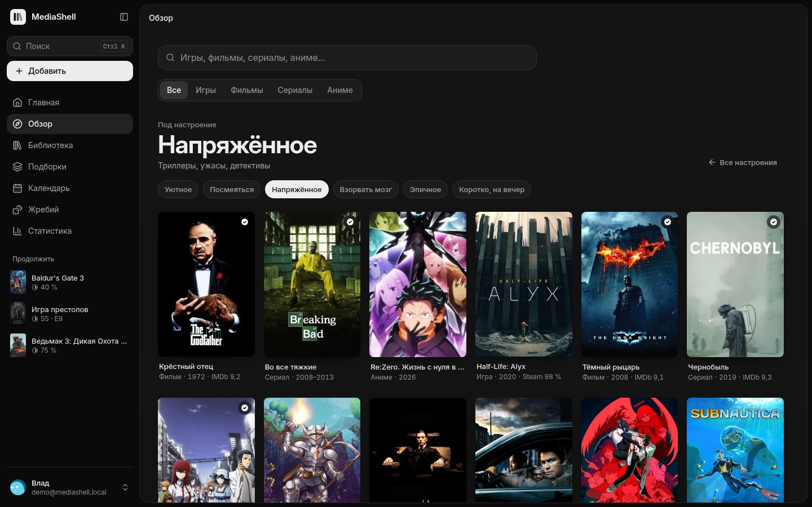</td>
    <td>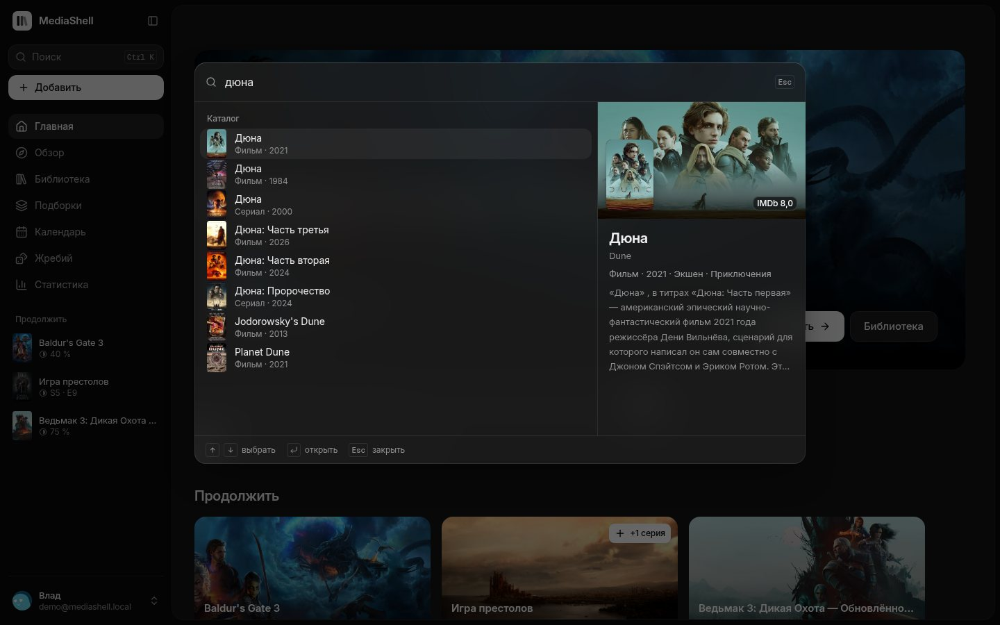</td>
  </tr>
  <tr>
    <td>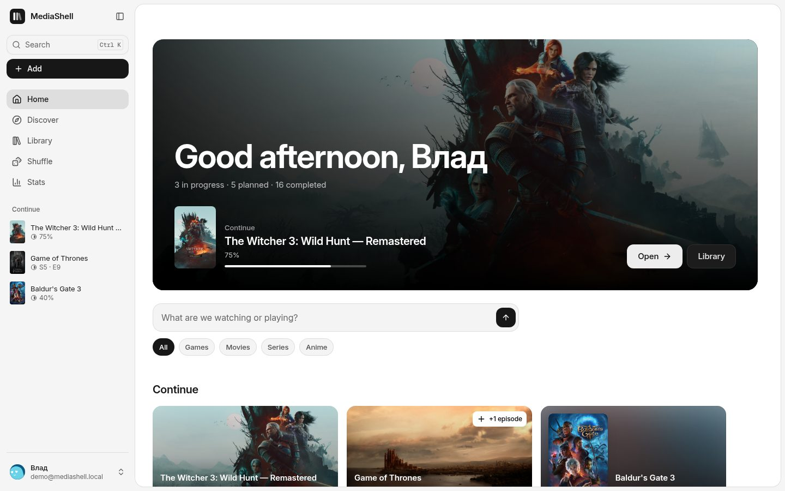</td>
    <td align="center">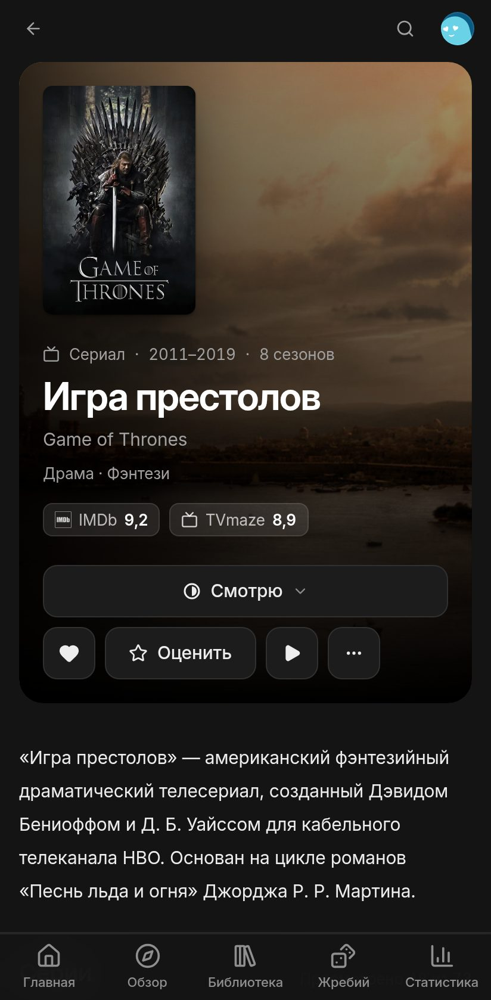</td>
  </tr>
  <tr>
    <td colspan="2" align="center">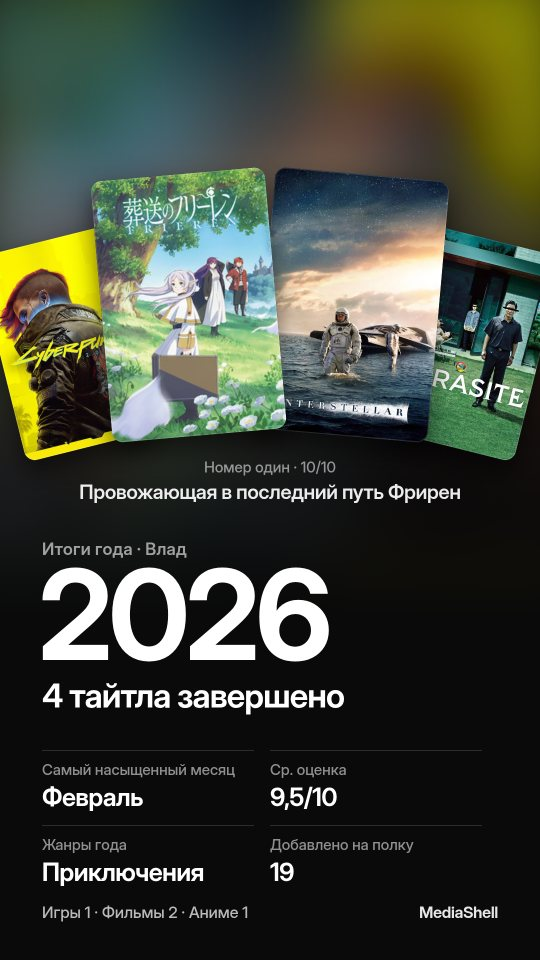</td>
  </tr>
</table>

## Возможности

- **Вход и регистрация.** Экран из двух колонок со стеной популярных постеров (на телефоне — лента над формой), подтверждение почты кодом. Новый аккаунт сразу попадает на короткую настройку: аватар и магазины, её можно пропустить.
- **Главная.** Первый экран — кадр того, что вы сейчас смотрите или проходите, с приветствием и главным действием («+1 серия» или «Открыть»); в пустой библиотеке — кадр из популярного. Ниже поиск, «Продолжить» с кнопкой «+1 серия», **«Новые серии»** (вышли у сериалов, которые вы досмотрели до конца, отметка одним нажатием) и **«Скоро выйдет»** (календарь серий на 30 дней с премьерами сезонов), планы, популярное по категориям, лента недавних действий. О новых сериях подсказывает значок у пункта «Главная».
- **Обзор.** Витрина: крупный кадр популярного тайтла, сменяется каждые 8 секунд (пауза под указателем и при «уменьшить движение», на телефоне листается свайпом). **«Под настроение»**: «Уютное», «Посмеяться», «Напряжённое», «Взорвать мозг», «Эпичное», «Коротко, на вечер» — подборки из популярного всех типов. Поиск по всем категориям (в том числе по-русски), топы «Популярное», «Лучшее за всё время», «Новинки». Фильтры по жанру, сортировка, «скрыть добавленные».
- **Календарь серий.** Месяц сеткой: в каждом дне постеры серий ваших сериалов и аниме (просмотренные с галочкой, сезон целиком — «×8»), справа список выбранного дня с «Просмотрено» в одно нажатие. Стрелки ходят по дням, PageUp/PageDown — по месяцам; на телефоне — список дней.
- **Свои подборки.** «Ужасы на Хеллоуин», «С друзьями»: любые тайтлы, не обязательно из библиотеки, кнопкой «В подборку» на странице тайтла. Видны на Главной и в профиле, переезжают вместе с экспортом.
- **Страница тайтла.** Фон и постер, рейтинги IMDb / Steam / Metacritic / Shikimori / AniList, описание на русском или английском, трейлер, кадры (на телефоне листаются свайпом), подробности, ссылки на источники.
- **Библиотека.** Три вида: сетка, список и доска статусов с перетаскиванием. Поиск, фильтры по категории и статусу, избранное, сортировка. Все фильтры сохраняются в адресе страницы.
- **Статусы:** В планах, В процессе, Отложено, Завершено, Брошено. У фильмов только «Хочу посмотреть» и «Просмотрено».
- **Сериалы и аниме.** Реальный список сезонов и серий. Можно отмечать серию, сезон или «все до этой», писать заметки и ставить оценку каждой серии. Статус меняется сам: первая серия переводит в «Смотрю», последняя серия завершившегося сериала — в «Просмотрено».
- **Игры.** Основное прохождение: платформа, магазин, прогресс, часы. До 9 дополнительных прохождений (другая платформа, NG+, кооператив). Цены Steam и GOG для вашего региона со скидками, ссылки на другие магазины.
- **Жребий** (бывший «Что сегодня?»). Случайный выбор из библиотеки (по статусам и категориям) или из популярного, с анимацией барабана и историей результатов. По желанию — щелчки барабана и вибрация на результате.
- **Статистика.** Итоги года, часы, серии, средняя оценка, завершённое по месяцам, распределение оценок, любимые жанры, рекорд активности. **«Картинка для соцсетей»** в конце итогов года: PNG 1080 × 1920 с лучшими постерами и цифрами года.
- **Настройки.** Профиль, тема (системная / светлая / тёмная), язык (русский, English, українська, Deutsch, Español, Français, Română; при первом входе — язык браузера), платформы, магазины и регион цен, смена пароля, активные сеансы, экспорт и импорт JSON, удаление аккаунта.
- **Импорт из других сервисов.** Список аниме из MyAnimeList или Шикимори (XML, в том числе `.xml.gz`), оценки и «Буду смотреть» из IMDb (CSV). Тайтлы сопоставляются по точным идентификаторам, то, что уже есть в библиотеке, не меняется, а названия, описания и фоны подтягиваются в фоне.
- **Отмена удаления.** «Вернуть» восстанавливает запись целиком: отмеченные серии с заметками и оценками, прохождения, даты.
- **Быстрый поиск** — `Ctrl K` (или `/`). Библиотека, каталог, переходы и действия в одном окне; справа превью выбранного тайтла: кадр, рейтинг, описание, ваш статус.
- **Клавиатура.** `?` — все сочетания клавиш; «G, затем H / D / L / P / C / R / S» — Главная, Обзор, Библиотека, Подборки, Календарь, Жребий, Статистика (работает и в русской раскладке).
- **Профиль.** Баннер, аватар, Топ-4, «Сейчас» крупной карточкой с кадром, подборки, жанры, последние действия.
- Мобильная версия с нижней панелью вкладок и кнопками не меньше 40–44 px на сенсорных экранах, работа с клавиатуры и видимый фокус, контраст текста 4,5:1 и выше, поддержка «уменьшить движение», тёмная и светлая темы без мигания при загрузке.

## Предпросмотр в Codespaces

1. На странице репозитория нажмите **Code → Codespaces → Create codespace on main**.
2. Дождитесь установки, это займёт несколько минут. Сайт откроется в браузере на порту 4175.
3. Создайте аккаунт. База лежит в папке `data` внутри codespace и пропадёт, если codespace удалить.

Codespaces бесплатен в пределах месячного лимита GitHub.

## Запуск на Windows (самый простой способ)

1. Установите **Node.js 24 LTS** с <https://nodejs.org>.
2. Дважды щёлкните `start.cmd` в папке проекта. При первом запуске он сам установит зависимости и соберёт сайт.
3. Откройте <http://localhost:4173> и создайте аккаунт. Точный адрес сервер пишет в окне.

Остановить сервер — закрыть окно. Данные лежат в `data\mediashelf.db`.

## Запуск из терминала

```powershell
npm install
npm run build
npm start          # http://localhost:4173
```

Режим разработки (горячая перезагрузка интерфейса и API):

```powershell
npm run dev        # интерфейс http://127.0.0.1:5173, API на порту 4174
```

## Доступ с телефона в той же Wi-Fi

Создайте файл `.env` рядом с `package.json`:

```ini
HOST=0.0.0.0
```

Перезапустите сервер и откройте на телефоне `http://<IP-адрес ноутбука>:4173`. IP можно узнать командой `ipconfig`. Windows спросит разрешение для Node.js в брандмауэре — разрешите для частных сетей. Сайт можно «Добавить на главный экран» как приложение.

## Настройки сервера (`.env`)

Все параметры описаны в `.env.example`. Основные:

| Переменная           | По умолчанию | Что делает                                                          |
| -------------------- | ------------ | ------------------------------------------------------------------- |
| `HOST`               | `127.0.0.1`  | `0.0.0.0` — доступ из локальной сети                                |
| `PORT`               | `4173`       | Порт сайта                                                          |
| `DATA_DIR`           | `data`       | Папка базы данных                                                   |
| `ALLOW_REGISTRATION` | `true`       | `false` — закрыть регистрацию (первый аккаунт создать можно всегда) |
| `SESSION_DAYS`       | `30`         | Сколько дней действует вход без активности                          |
| `TRUST_PROXY`        | `false`      | `true` только за своим HTTPS-прокси (Caddy, nginx)                  |
| `COOKIE_SECURE`      | `auto`       | Cookie с флагом Secure для HTTPS                                    |

## Резервные копии и обновление

- **Резервная копия** — скопируйте папку `data` при остановленном сервере. Отдельную библиотеку можно скачать в «Настройки → Данные → Экспорт».
- **Обновление** — `git pull`, `npm install`, `npm run build`, перезапуск. Схема базы обновляется автоматически.

## Когда захотите выложить в интернет

Сервер уже готов к публикации: пароли хешируются scrypt, сессии хранятся в HttpOnly-cookie (в базе — только хеш токена), есть защита от CSRF по Origin, ограничение попыток входа, строгий CSP и заголовки безопасности.

1. Поставьте перед MediaShell HTTPS-прокси. Например, Caddy: `media.example.com { reverse_proxy 127.0.0.1:4173 }`.
2. В `.env`: `TRUST_PROXY=true`, после создания своих аккаунтов — `ALLOW_REGISTRATION=false`.
3. Или Docker: `docker compose up -d --build`. Данные хранятся в томе `mediashelf-data`.

## Откуда данные

Ключи API не нужны. Все ответы кешируются: частые — в памяти, дорогие (названия и описания из Википедии) — в SQLite.

- **Игры:** Steam (чарты, поиск, описания, отзывы, цены), GOG (каталог и цены).
- **Фильмы и сериалы:** IMDb-поиск, Cinemeta (топы, описания, трейлеры), TVmaze (серии), Wikidata и Википедия (русские названия и описания).
- **Аниме:** Shikimori (русские названия и описания), AniList (тренды, английские описания, фоны), MyAnimeList через Jikan (названия серий).

Если источник недоступен, библиотека продолжает работать: сохранённые тайтлы и списки серий хранятся локально.

## Проверки

```powershell
npm run check       # TypeScript + ESLint + модульные и API-тесты
npx playwright install chromium   # один раз
npm run test:e2e    # сборка и сквозные тесты в браузере (офлайн-каталог, база в памяти)
```

## Устройство проекта

```
shared/            общие типы, схемы zod, статусы, жанры, регионы
server/            Node.js 24 + Hono; TypeScript запускается без сборки
  auth/            пароли (scrypt), сессии, пользователи
  catalog/         Steam, GOG, Cinemeta, IMDb, TVmaze, Shikimori, AniList, Wikidata
  library/         записи, серии, прохождения, активность, статистика, экспорт
  routes/          HTTP API
  db/              SQLite (node:sqlite) и миграции
src/               React 19 + Vite + Tailwind CSS 4 + Radix + TanStack Query
  app/             оболочка: боковая панель, мобильные вкладки, Ctrl K
  components/      дизайн-система (ui/) и общие компоненты
  pages/           страницы
  i18n/            русский (основной), английский, украинский, немецкий, испанский, французский, румынский
tests/e2e/         сквозные тесты Playwright
```

Дизайн описан в [DESIGN.md](DESIGN.md), продукт — в [PRODUCT.md](PRODUCT.md).

---

## English summary

MediaShell is a self-hosted library for games, movies, series and anime. It has accounts, episode and playthrough tracking, new and upcoming episodes of the shows you follow with a month calendar, your own collections, browsing by mood, a status board, stats with a shareable «My year» picture, Shuffle (random pick), a Ctrl K command palette with a title preview, keyboard shortcuts (`?`), import from MyAnimeList, Shikimori and IMDb, and a UI in Russian, English, Ukrainian, German, Spanish, French and Romanian (the browser's language on a first visit) in light and dark themes.

**Run:** install Node.js 24, then `npm install && npm run build && npm start` and open http://localhost:4173. On Windows you can double-click `start.cmd` instead. Data lives in `data/mediashelf.db`. Settings are in `.env.example`.

## Credits

Avatars are generated in the browser from a seed (`src/components/avatar-gen.ts`). The blob faces follow Boring Avatars “Beam” (MIT, © 2021 boringdesigners), the rounded figures use eyes and mouths from DiceBear “Thumbs” (CC0 1.0). The accessories (hats, glasses, ties, cat ears, the duck and the rest) are drawn for MediaShell, as stickers with a white edge so they read at any size.
